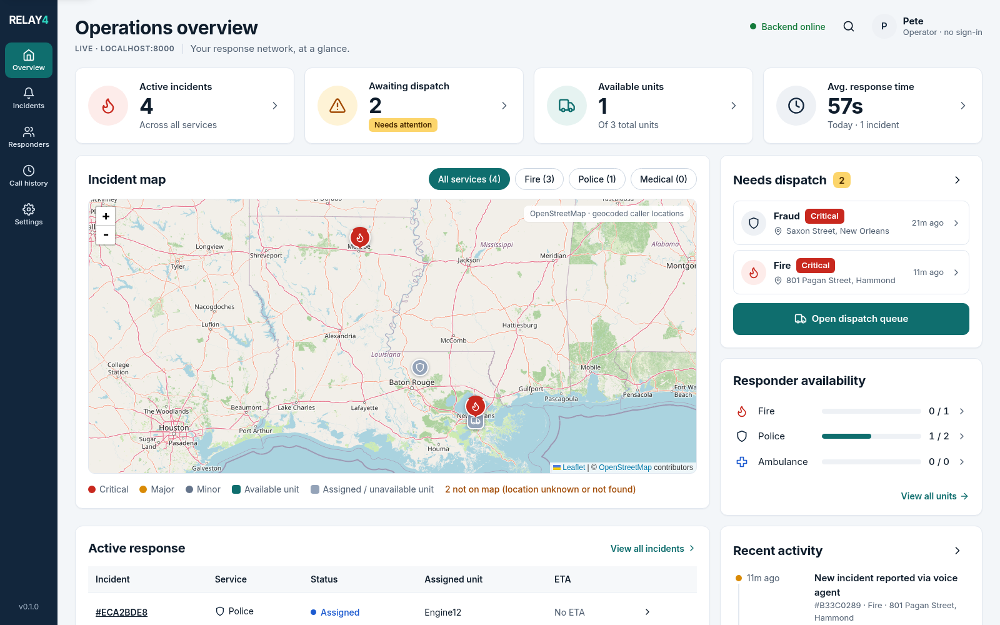
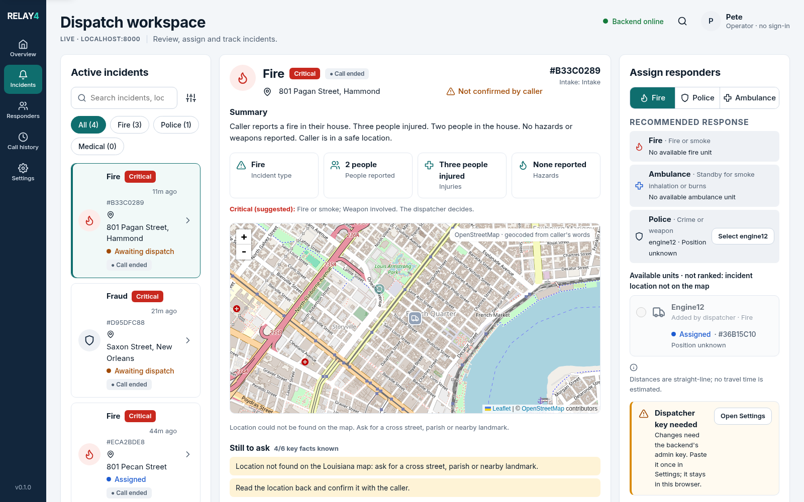

# Relay4

Relay4 is a Louisiana-focused emergency voice-intake and incident-coordination MVP. It turns an ElevenLabs conversation into a shared incident record that a dispatcher can review, correct, and assign from one operational workspace.

> **Safety and scope:** Relay4 is a synthetic hackathon system. It does not contact 911, emergency services, or real responders. The voice agent records intake facts; a human dispatcher controls assignments. Treat every displayed location, priority, distance, and status as unverified until a qualified operator confirms it.



## What Relay4 does

- Captures structured incident facts from an ElevenLabs voice conversation.
- Preserves caller evidence, conversation IDs, corrections, and event history.
- Shows incidents, severity suggestions, missing facts, locations, related reports, and responder availability.
- Lets a dispatcher explicitly assign a unit and record response events.
- Keeps intake/review status separate from operational response status.
- Marks a conversation as ended after 20 seconds without a new intake update.
- Uses Louisiana landmarks, parish context, and map geocoding to support location clarification.

## How the system fits together


The voice webhook can open and update an incident, but it cannot assign a responder. The backend returns `dispatch_confirmed: false` until a dispatcher records an assignment. The current MVP does not notify a real responder or calculate road ETA; straight-line distances are labelled as such.

## Product walkthrough

### Operations overview

The overview brings together active incidents, the dispatch queue, map locations, available units, response metrics, and recent activity.


### Incident workspace

The incident workspace combines the queue, caller facts, evidence and history, map context, missing-information prompts, and the responder assignment panel.




## Repository guide

| Area | Purpose |
| --- | --- |
| [`backend/`](backend/README.md) | FastAPI API, SQLite persistence, ElevenLabs tools, dispatch records, auth, and tests |
| [`frontend/`](frontend/README.md) | React/Vite dispatcher console and demo data source |
| [`RUNNING.md`](RUNNING.md) | Complete local setup, tunnel, ElevenLabs configuration, smoke tests, and troubleshooting |
| [`docs/architecture.md`](docs/architecture.md) | Domain model and product flow |
| [`openapi.json`](openapi.json) | Checked-in API description for the current backend boundary |

Start with [`RUNNING.md`](RUNNING.md) if you want to launch the project. Read [`backend/README.md`](backend/README.md) or [`frontend/README.md`](frontend/README.md) for component-specific details.

## Quick start

From the repository root:

```bash
cd backend
python -m venv .venv
source .venv/bin/activate
pip install -r requirements.txt
cp .env.example .env
uvicorn app.main:app --reload --port 8000
```

In a second terminal:

```bash
cd frontend
cp .env.example .env
npm install
npm run dev -- --host 127.0.0.1 --port 5173
```

Open <http://127.0.0.1:5173>. The live console reads the backend at <http://localhost:8000>. For the complete setup, use [`RUNNING.md`](RUNNING.md).

## ElevenLabs development tunnel

To receive webhook tool calls from ElevenLabs while the backend is local:

```bash
cloudflared tunnel --url http://localhost:8000
```

Use the generated HTTPS hostname with these paths:

```text
POST https://YOUR-TUNNEL.trycloudflare.com/api/elevenlabs/tools/start-incident
POST https://YOUR-TUNNEL.trycloudflare.com/api/elevenlabs/tools/upsert-incident
```

The tunnel URL is temporary and changes when `cloudflared` stops. Never put `.env` files, API keys, webhook secrets, or dispatcher keys in the repository.

## Verification

```bash
cd backend
.venv/bin/pytest -q

cd ../frontend
npm run build
```

The test suite covers webhook authentication, idempotency, conversation binding, evidence, corrections, dispatch conflicts, assignment rules, and the conversation-start endpoint.

## Current limitations

- Synthetic workflow only; no public-safety or emergency-services integration.
- Responder assignments are recorded in the backend but do not notify a real unit.
- Road routing and ETA are not connected; straight-line distance is clearly labelled.
- Live audio playback is not connected in the live backend mode.
- The 20-second conversation-ended indicator is inferred from the last incident update because no explicit call-ended event is stored yet.
